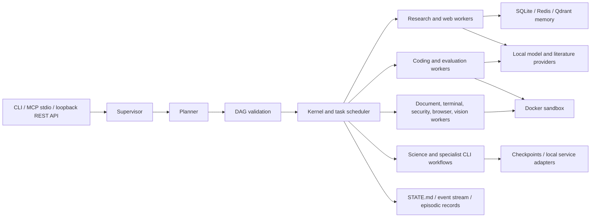

# ARK OS architecture

The active application is a C++20 runtime. The Python source tree remains as a
migration reference and is not used to build `ark-cpp`.

## Execution path

The shared task path classifies a goal, asks the planner for a dependency
graph, validates task IDs and edges, dispatches ready tasks, supplies completed
dependency results, evaluates eligible outputs, applies bounded retries, and
records task status. CLI, MCP, and the loopback API enter this C++ runtime.
The MCP server exposes five tools over stdio. Export commands write a result
to a local Obsidian vault or, when explicitly invoked with credentials, create
a Notion page.

## Data and execution boundaries

- Redis holds shared working state, registry entries, and revision metadata.
- SQLite holds episodic records, procedural skills, schedules, and local
  synchronization state.
- Qdrant serves semantic vector retrieval; the native runtime also has a local
  SQLite vector index for fallback and replay.
- Coding, terminal, and defensive security tasks use the Docker execution
  boundary. Generated commands and code are not run directly on the host.
- The HTTP API binds to loopback. Remote access should use an SSH tunnel or an
  explicitly secured proxy.
- External literature and Notion exports are network operations governed by
  configuration or explicit export commands.

## Integration status

The runtime has dedicated paths for selected research, coding, evaluation,
browser, web-search, and vision workers. Other native specialists are exposed
through direct C++ CLI workflows or narrower benchmark adapters. The planned
single-task workflow that activates all 20 agents has not been demonstrated;
see the [integration audit](docs/day96_agent_integration.md). Component tests
and benchmark fixtures must not be read as evidence of complete live-system
integration.

## Further reading

- [Native build and runtime guide](docs/native_cpp.md)
- [Deployment guide](docs/deployment_guide.md)
- [Current project status](docs/project_status.md)
- [Week 15 review and verification limits](docs/week15_review.md)
