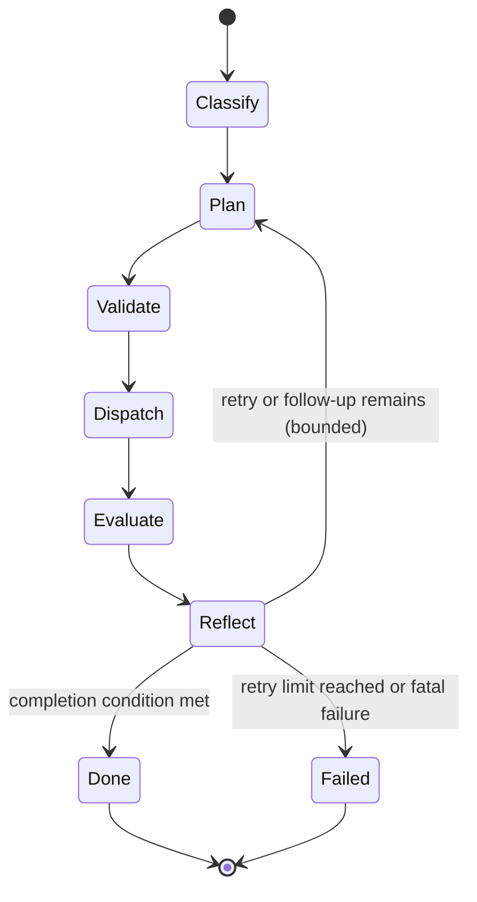

# ARK OS paper draft

## Architecture

ARK OS is a native C++20 runtime for workflows that combine specialist
workers, local model inference, persistent memory, and isolated code
execution. The CLI and loopback API submit goals to the same execution path.
Workers exchange an `ARKMessage` envelope containing task identity, intent,
status, dependencies, evidence, and agent version. This shared representation
supports both dispatch and post-run inspection.

### Planning and dispatch

The supervisor classifies a goal and the planner produces a directed acyclic
graph of worker tasks. The runtime validates task identities, dependencies,
and available workers before execution. It schedules tasks by dependency
layer, supplies completed upstream results as input, and reuses independent
work during retries. The evaluation worker records structured ratings. Low
ratings can send feedback upstream. The supervisor caps retry attempts and
records unresolved outcomes for inspection.

### Storage and execution boundaries

Redis stores working state, agent registry entries, and agent revisions.
Each revision identifies a model and prompt snapshot. Workers use the
selected snapshot throughout a dispatch, and the runtime records the version
in result messages and episodic records. SQLite stores episodic history and
procedural skills, and Qdrant indexes semantic records for retrieval. Model
and embedding requests use loopback endpoints. Research workers consult a
provider policy for external literature requests. Coding workers run tests in
Docker containers with bounded resources and disabled networking.

### Observability and evaluation

The terminal, REST API, and dashboard expose task status and persistent
evidence, including the selected agent revisions. A WebSocket stream reports
worker activity and storage events. The ARKBench runner uses fixed producer
and evaluator graphs so that repeat runs share a plan. Research cases check
the required citations. Coding cases execute a separate acceptance suite on
the submitted solution. The results record completion, elapsed time, and the
evaluator's ratings alongside the evidence checks. This design supports
comparisons between recorded configurations using the same dataset.

### Resource coordination and native workflows

The runtime bounds concurrent browser, terminal, and arXiv operations with
FIFO semaphores. Research dispatch assigns work among two process-local slots
using assignment counts and evaluator history. An evaluator score below the
configured threshold deprioritizes a slot, while an unrated slot remains
eligible. This policy routes requests among logical instances; it does not
imply separate model servers or machines.

The kernel can execute dependency graphs that combine local document, terminal,
and defensive security workers. The Month 4 benchmark adapter opts these
workers into its validated DAG path and restricts fixture data flow to selected
tool output strings written into document paragraph text. The adapter records
each participating agent version with the case result. In the 20-task
concurrency fixture, observed peaks matched configured resource capacities and
all SQLite writes survived. This measurement covers scheduling and local
storage, not inference or external tool throughput.

The final v1.0 evaluation includes 50 cases. On the ten unchanged research and
coding task IDs, the measured score rose from 0.4035 in the recorded Month 2
baseline to 0.438, an 8.55% relative improvement. The overall 50-case mean is
reported separately because it includes new deterministic tool workflows.
This aggregate does not show a uniform gain: research moved from 0.518 to
0.736, while coding moved from 0.289 to 0.140. Both reports label the agents
version `1.0.0`, so this comparison is not evidence that prompt self-improvement
caused the increase. The Month 4 report also lacks the per-agent model
fingerprints recorded in the Month 2 provenance. These results support a
matched-cohort observation, not a causal claim about the source of the change.

### Integration limits

The shared planner path is narrower than the collection of native worker
modules. A normal `ark-cpp run` offers a limited research/coding/evaluation
set plus selected browse and vision paths, and dispatches only selected agent
types through dedicated branches. Document, terminal, and security workflows
can be composed through the validated native-tool DAG path used by ARKBench,
while DevOps, ML Engineer, Data Analysis, GitHub, and SAGE specialists remain
direct CLI workflows. The flagship goal that activates all 20 agents in one
run has not been demonstrated. The unit and workflow tests establish component
behavior but do not establish that full-system integration criterion.

The prompt-improvement gate and capability evidence map are implemented in
native C++, with fixture tests. Neither has been run against live reflection,
registry, inference, or benchmark services in the current environment. The
multimodal training stage also remains unstarted: the installed llama.cpp
trainer does not implement the guide's projection-plus-LoRA workflow. See the
[Month 5 evidence review](../month5_results.md),
[matched self-improvement analysis](../self_improvement_evidence.md), and
[all-agent integration audit](../day96_agent_integration.md) for the exact
verification scope.

The task inspector derives the displayed edges from the validated plan.
The figure shows a three-stage workflow with a live-state fixture.

The version panel groups scored cases by producer and revision for each
completed benchmark run. This figure shows the first recorded baseline.

## Methods

### AgentSpec v1.0 message contract

Each worker request is a JSON object that preserves the frozen AgentSpec v1.0
field names across the Python-to-C++ migration. `make_message` assigns a unique
task ID, UTC timestamp, `PENDING` status, empty output and memory context,
priority 5, retry count 0, maximum retries 3, quality score -1 (not yet scored),
and an empty agent version. Workers fill output, status, score, and the version
they used. The accepted intents are `RESEARCH`, `CODE`, `SEARCH`, `EXECUTE`,
`STORE`, `EVALUATE`, `REFLECT`, `DISCOVER`, `SUPERVISE`, `PLAN`, `BROWSE`,
`SECURITY`, and `VISION`. Status transitions use `PENDING`, `RUNNING`, `DONE`,
`FAILED`, or `RETRY`.

| Field group | Fields | Purpose |
| --- | --- | --- |
| Routing | `task_id`, `sender`, `receiver`, `parent_task_id` | Unique task and parent-child routing. |
| Intent and content | `intent`, `payload`, `memory_context` | Worker operation and its input/context. |
| Control | `priority`, `status`, `retry_count`, `max_retries` | Scheduling, lifecycle, and bounded retry state. |
| Output | `output`, `quality_score`, `timestamp` | Result artifact, evaluator score, and creation time. |
| Provenance | `agent_version` | Prompt/model revision used for the result. |

The runtime checks envelope fields before accepting pending work. Payload
schemas are worker-specific and validated by the selected agent. The C++
message factory fills every contract field, while APIs can still accept older
messages that contain the required routing subset.

### Four-tier memory model

Memory is modeled by access lifetime and retrieval method rather than one
general-purpose history store:

| Tier | Primary record | Store and retrieval semantics | Lifetime |
| --- | --- | --- | --- |
| Working | Task-scoped key/value state | Redis keys with TTL; task completion caps their remaining lifetime. A bounded process-local fallback is used when Redis is unavailable. | Temporary. |
| Episodic | Completed task and reflection event | Append-only SQLite rows queried by agent, intent, version, time, or keyword. | Persistent history. |
| Semantic | Paper or other factual record plus metadata | Text embeddings and cosine retrieval; Qdrant is the vector service, with a local SQLite index for synchronization and service-offline operation. | Persistent, with age-based eviction. |
| Procedural | Reusable skill steps and success history | SQLite records with normalized vectors; exact cosine scan over a bounded candidate set and success-weighted retrieval. | Persistent, with low-success pruning. |

The tiers have distinct write policies: working state expires, episodic history
is append-only, semantic records can be removed or evicted after inactivity,
and procedural skills track successful reuse. These definitions describe the
native stores; the general task dispatcher does not yet route every worker's
memory access exclusively through one memory-agent adapter.

### Hardware-adaptive local model selection

`config/model-library.json` maps hardware tiers to general, coding, and vision
models. The runtime detects VRAM and RAM, chooses the T1–T5 tier, then writes
the selected profile to `config/active-models.json`. The current selector uses
these VRAM thresholds: zero selects T5, less than 6 GiB selects T1, less than
14 GiB selects T2, less than 22 GiB selects T3, and 22 GiB or more selects T4.
T1/T2 target smaller GPU budgets; T3/T4 select larger general and coding
models; T5 is the no-GPU profile. A `null` vision entry means that the tier has
no configured vision model. Model names are configuration, not proof that the
corresponding weights are installed. The inference adapter routes chat and
embeddings to loopback Ollama or llama.cpp endpoints; llama.cpp can keep one
GGUF role loaded and switch general, coding, and vision weights as requested.

### Native orchestration state machine

The original graph behavior is represented directly in the C++ supervisor and
task scheduler rather than by a Python LangGraph dependency. The main lifecycle
is:

Within `Dispatch`, tasks run in dependency layers; independent tasks may run
concurrently. The DAG validator rejects cycles, missing dependencies, unknown
workers, and duplicate IDs before a task starts. Worker failures and transient
HTTP errors are handled by bounded retries; evaluation feedback is supplied to
the retry attempt. This state diagram describes the existing native path, not
the all-20-agent integration criterion, which remains open.

### Local inference architecture

A shared C++ adapter routes structured chat and embeddings to the selected
loopback inference service. With llama.cpp selected, the adapter sends chat
completions and embedding requests to a local llama-server. The model router
loads the GGUF named by the agent profile and can cap the number of resident
models at one. This supports alternating general, coding, and vision models
on a device with limited memory. Vision inference loads the model's matching
projector and accepts image data with the user message. Ollama manifests can
resolve downloaded GGUF and projector paths for the server presets.

The inference experiment used ten coding prompts and one GGUF quantization
for both engines on an RTX 5060 Laptop GPU. Each engine received a warmup
request before measurement. The runtime recorded request latency, reported
generation throughput, and structured output validity for each prompt.
The coding repair benchmark separately uses locked unittests in Docker to
measure correctness of the generated patch. [Month 3 results](../month3_results.md)
