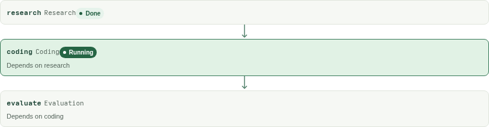
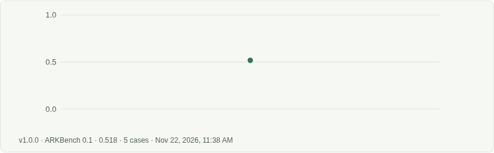

# ARK OS paper draft

## Architecture

ARK OS is a native C++20 runtime for workflows that combine specialist
workers, local model inference, persistent memory, and isolated code
execution. The CLI and loopback API submit goals to the same execution path.
Workers exchange an `ARKMessage` envelope containing task identity, intent,
status, dependencies, evidence, and agent version. This shared representation
supports both dispatch and post-run inspection.

### Planning and dispatch

The supervisor classifies a goal and the planner produces a directed acyclic
graph of worker tasks. The runtime validates task identities, dependencies,
and available workers before execution. It schedules tasks by dependency
layer, supplies completed upstream results as input, and reuses independent
work during retries. The evaluation worker records structured ratings. Low
ratings can send feedback upstream. The supervisor caps retry attempts and
records unresolved outcomes for inspection.

### Storage and execution boundaries

Redis stores working state, agent registry entries, and agent revisions.
Each revision identifies a model and prompt snapshot. Workers use the
selected snapshot throughout a dispatch, and the runtime records the version
in result messages and episodic records. SQLite stores episodic history and
procedural skills, and Qdrant indexes semantic records for retrieval. Model
and embedding requests use loopback endpoints. Research workers consult a
provider policy for external literature requests. Coding workers run tests in
Docker containers with bounded resources and disabled networking.

### Observability and evaluation

The terminal, REST API, and dashboard expose task status and persistent
evidence, including the selected agent revisions. A WebSocket stream reports
worker activity and storage events. The ARKBench runner uses fixed producer
and evaluator graphs so that repeat runs share a plan. Research cases check
the required citations. Coding cases execute a separate acceptance suite on
the submitted solution. The results record completion, elapsed time, and the
evaluator's ratings alongside the evidence checks. This design supports
comparisons between recorded configurations using the same dataset.

The task inspector derives the displayed edges from the validated plan.
The figure shows a three-stage workflow with a live-state fixture.

The version panel groups scored cases by producer and revision for each
completed benchmark run. This figure shows the first recorded baseline.

## Methods

### Local inference architecture

A shared C++ adapter routes structured chat and embeddings to the selected
loopback inference service. With llama.cpp selected, the adapter sends chat
completions and embedding requests to a local llama-server. The model router
loads the GGUF named by the agent profile and can cap the number of resident
models at one. This supports alternating general, coding, and vision models
on a device with limited memory. Vision inference loads the model's matching
projector and accepts image data with the user message. Ollama manifests can
resolve downloaded GGUF and projector paths for the server presets.

The inference experiment used ten coding prompts and one GGUF quantization
for both engines on an RTX 5060 Laptop GPU. Each engine received a warmup
request before measurement. The runtime recorded request latency, reported
generation throughput, and structured output validity for each prompt.
The coding repair benchmark separately uses locked unittests in Docker to
measure correctness of the generated patch. [Month 3 results](../month3_results.md)
